# Basic Employee Onboarding (AD)(RBAC)

## Project Overview

Built a simulated Active Directory environment for Northstar Medical Group (NMG), a fictional healthcare organization, to practice employee onboarding, identity management, and access troubleshooting.

The project demonstrates hands-on experience with Windows Server 2019, Active Directory Domain Services (AD DS), and Role-Based Access Control (RBAC) principles.

## Problem Statement

NMG's fictional IT environment lacked a standardized Active Directory structure due to poor administration by a previous Managed Service Provider (MSP). Inconsistent user provisioning and security group assignments increased the risk of incorrect employee access and potential HIPAA compliance concerns.

## Solution Overview

I built the NMG.com Active Directory domain using Windows Server 2019, with NMG-DC01 serving as the domain controller.

To organize employee accounts, I created 4 departmental OUs (Finance, HR, IT, and Operations) and 4 corresponding security groups to support Role-Based Access Control (RBAC).

I then provisioned 15 employee accounts, assigning each to the appropriate department and security group.

To put these skills into practice, I resolved a simulated high-priority support ticket (NMG-0047) involving an employee assigned to the wrong department and security group. This demonstrated my ability to identify and correct common Active Directory account management issues.

## Video Walkthrough

[Watch Project Walkthrough on Loom](https://www.loom.com/share/fbe607f2b96f4037b5bf552d06fefba5)

## Tools Used

* Windows Server 2019 - Server Operating System
* Active Directory Domain Services - Domain Administration and Identity Management
* Oracle VirtualBox - Virtualized Lab Environment
* Active Directory Users and Computers - User, OU, and Security Group Administration
* Role-Based Access Control (RBAC) - Department-Based Access Management
* GitHub - Project Documentation and Evidence

## Project Timeline & Evidence

### Day 1 — Domain Creation and Configuration

Installed Windows Server 2019, configured Active Directory Domain Services, and promoted NMG-DC01 to a domain controller for NMG.com.

**Domain Creation**

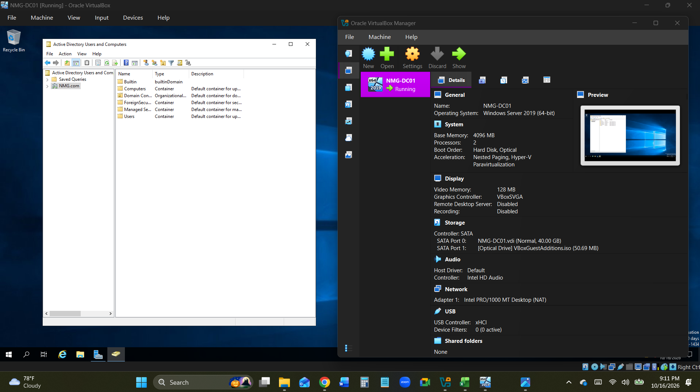

**Server Manager**

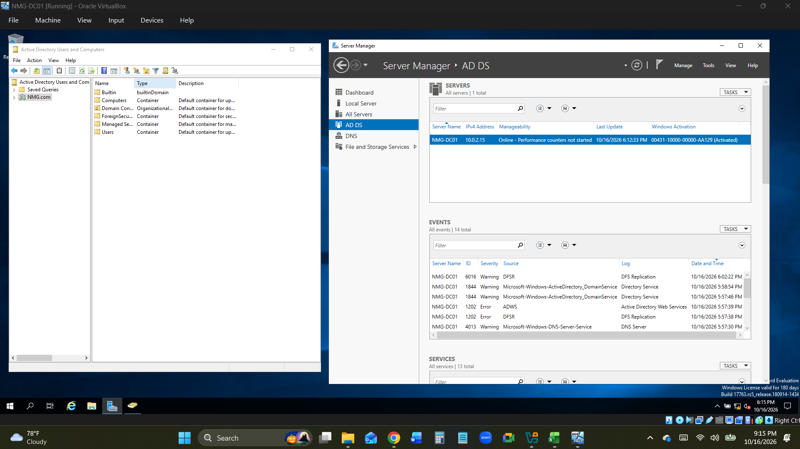

**Domain Controller Diagnostics**

Used `dcdiag` to verify domain controller health.

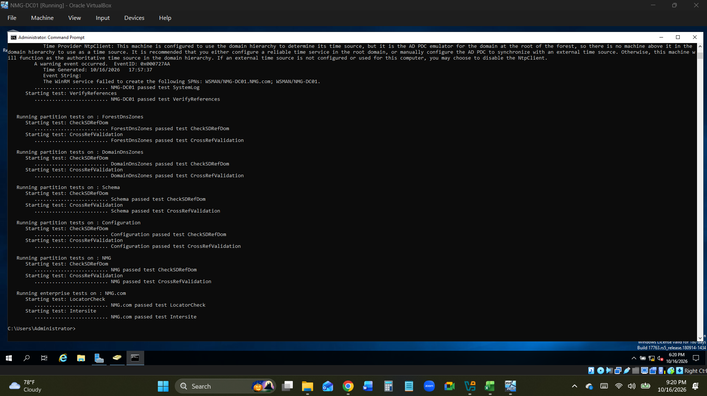

### Day 2 — Organizational Units and Security Groups

Created four departmental OUs and corresponding security groups to organize employee identities and support RBAC.

**Departmental Organizational Units**

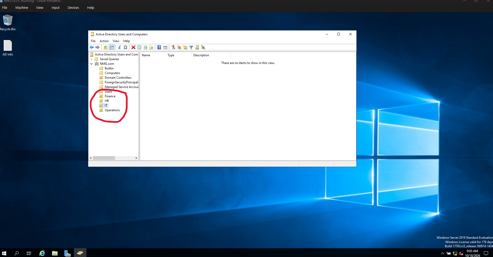

**OU and Security Group Structure**

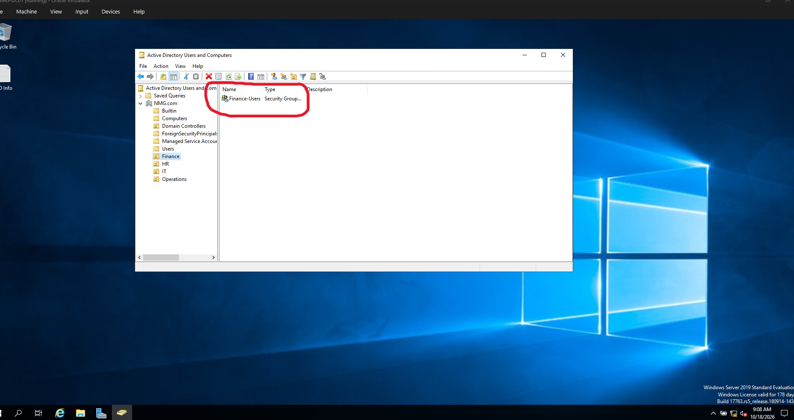

**Operations Department Users**

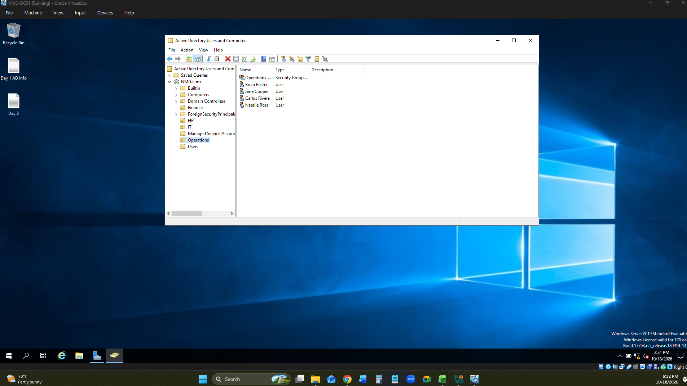

**Operations Security Group**

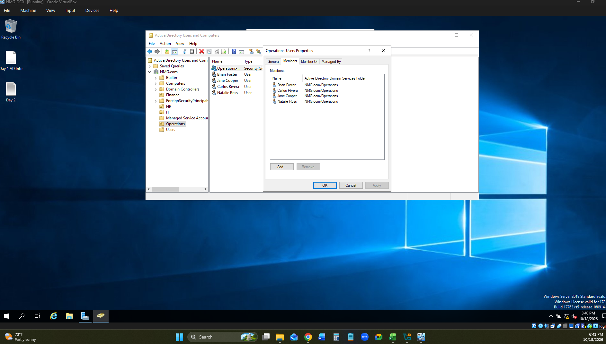

### Day 3 — User Provisioning and RBAC

Provisioned 15 fictional employee accounts and organized them by department.

Assigned employees to departmental security groups based on their job responsibilities.

**Active Directory Structure**

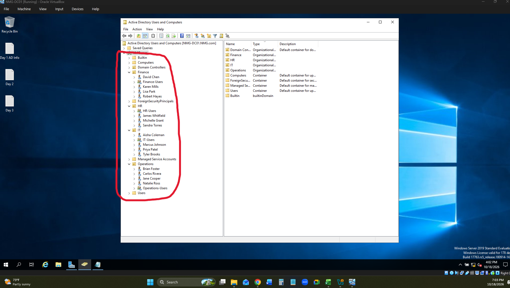

### Day 4 — Help Desk Incident NMG-0047

Investigated a simulated high-priority support ticket involving Jane Cooper, an HR Payroll Specialist experiencing incorrect access permissions and workstation configuration.

**Original Support Ticket**

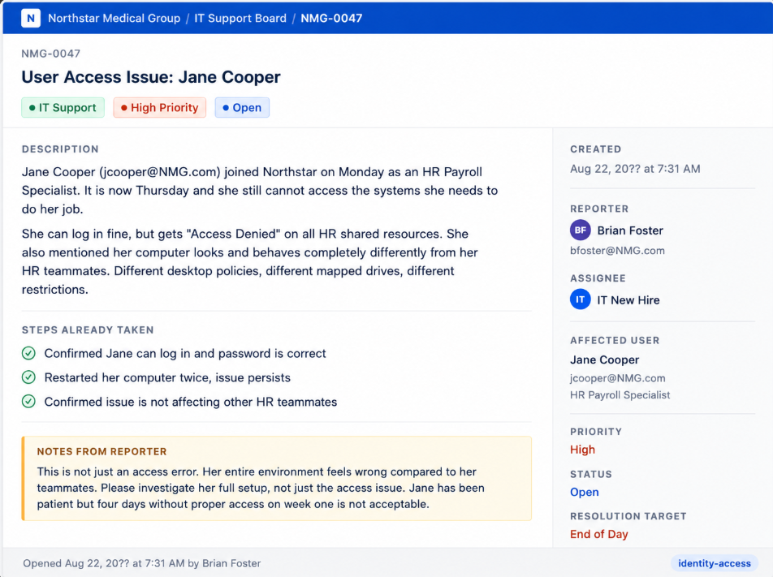

**Incorrect OU Placement**

Identified that Jane Cooper was assigned to an incorrect organizational unit.

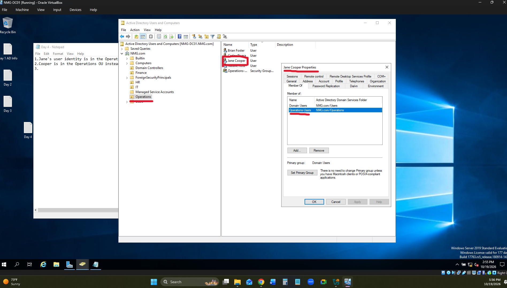

**Corrected OU Placement**

Moved Jane Cooper to the appropriate HR organizational unit.

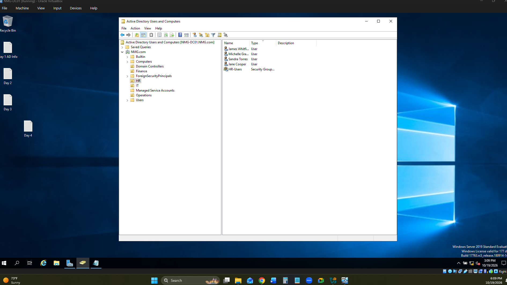

**Corrected Security Group Membership**

Verified Jane Cooper's membership in the appropriate departmental security group.

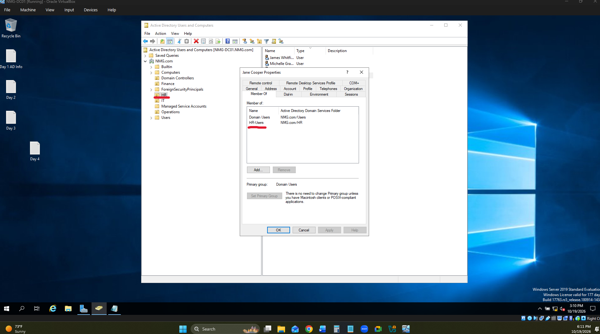

**Resolution**

Corrected the employee's OU placement and security group membership to align with her HR role.

### Day 5 — Documentation and Project Review

Organized project evidence, reviewed the Active Directory configuration, and prepared the GitHub documentation and video walkthrough.

## Key Accomplishments

* Built the NMG.com Active Directory domain from scratch.
* Configured Windows Server 2019 as a domain controller.
* Created 4 departmental OUs and 4 security groups.
* Provisioned 15 fictional employee accounts.
* Implemented department-based RBAC principles.
* Investigated and resolved simulated ticket NMG-0047.
* Verified correct OU placement and security group membership.
* Documented technical implementation with screenshots and a Loom walkthrough.

## Skills Demonstrated

* Windows Server Administration
* Active Directory Domain Services (AD DS)
* Domain Controller Configuration
* Organizational Unit Management
* Security Group Administration
* Role-Based Access Control (RBAC)
* User Provisioning and Onboarding
* Active Directory Troubleshooting
* IT Help Desk Incident Resolution
* Technical Documentation

